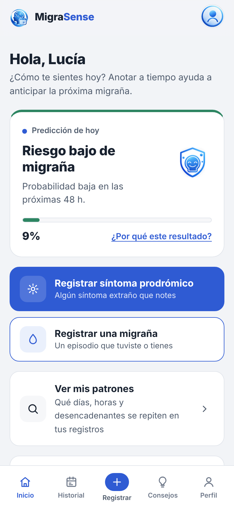
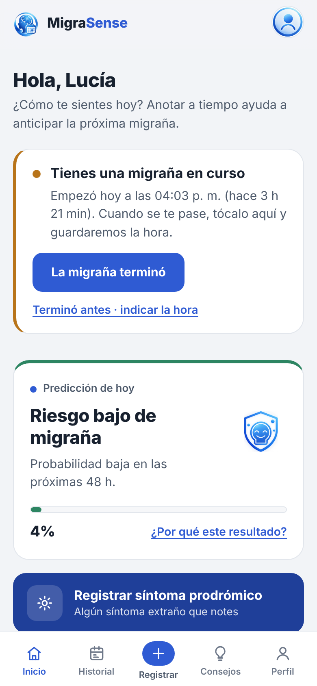
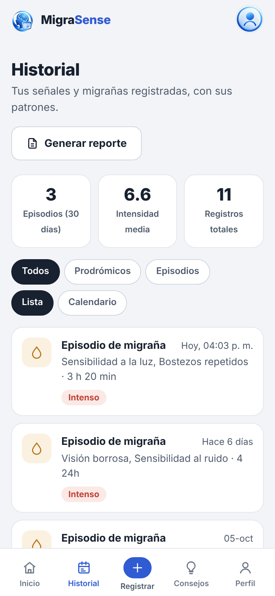
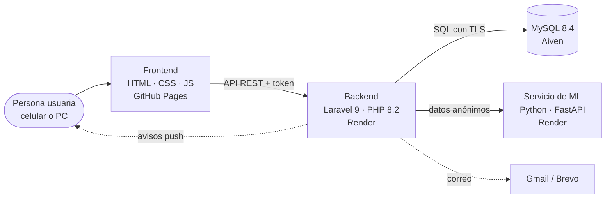

<p align="center">
  
</p>

<h1 align="center">MigraSense</h1>

<p align="center">
  Registro de síntomas y predicción de episodios de migraña<br>
  <sub>Proyecto de Sistemas I · Universidad del Valle (UNIVALLE) · 2026</sub>
</p>

<p align="center">
  <a href="https://miguelhuanca676-bot.github.io/migrasense/"><strong>Abrir la aplicación</strong></a> ·
  <a href="docs/manual-de-usuario.md">Manual de usuario</a> ·
  <a href="docs/README.md">Documentación técnica</a> ·
  <a href="CHANGELOG.md">Versiones</a>
</p>

---

## ¿Por qué hicimos esto?

Quien tiene migraña sabe que el dolor casi nunca llega "de la nada". Horas o incluso un día antes suelen
aparecer señales pequeñas: bostezos que no paran, cansancio raro, molestia con la luz, ganas de comer algo
en particular, el cuello rígido. A eso se le llama **fase prodrómica**, y el problema es que casi nadie la
anota, así que cuando llega la crisis ya es tarde para prevenirla.

MigraSense nació de esa idea: una app sencilla donde la persona anota lo que siente en pocos toques y que,
con esos registros, le avise cuándo es más probable que se venga una migraña. No reemplaza al médico; la
pensamos como una libreta inteligente que además le sirve al especialista, porque genera un reporte en PDF
con todo el historial.

## Qué puede hacer

- **Cuestionario inicial** de 13 preguntas para conocer el perfil de migraña de cada persona (frecuencia, duración,
  horas de sueño, estrés, cafeína, condiciones médicas).
- **Registrar un síntoma prodrómico** en segundos, con "Más información" en cada síntoma para no confundirse.
- **Registrar una migraña**: intensidad, desencadenantes, si tuvo aura, medicación y duración. Si la migraña
  está pasando en ese momento se marca como **"Aún en curso"** y desde Inicio se toca **"La migraña terminó"**.
- **Predicción del riesgo** para las próximas 24–48 horas con un modelo de *machine learning*, explicando
  qué factores subieron o bajaron el porcentaje.
- **Historial** con filtros, calendario, gráficos de patrones y **reporte en PDF** para llevar al médico.
- **Recordatorios reales**: aviso diario en el celular aunque la app esté cerrada, y un resumen semanal con el
  PDF por correo.
- **Cuenta segura**: recuperación de contraseña por correo, cambio de clave, eliminación de la cuenta y de
  todos sus datos.
- Diseño **tranquilo para ojos sensibles a la luz**, modo oscuro y uso cómodo en celular, tablet o PC.

<p align="center">
  
  
  
</p>

## Cómo está armado

Son tres piezas que se hablan por internet:



| Parte | Tecnología | Dónde vive |
|---|---|---|
| Frontend | HTML, CSS y JavaScript sin frameworks (PWA) | `/` (raíz de este repo) · publicado en GitHub Pages |
| Backend / API | Laravel 9, Sanctum, Argon2id | [`Backend_Laravel/`](Backend_Laravel) · Render (Docker) |
| Base de datos | MySQL 8.4: 23 tablas, 6 vistas, 11 procedimientos, 5 triggers | [`database/`](database) y `Backend_Laravel/database` · Aiven |
| Machine learning | Python, scikit-learn, FastAPI | repo [migrasence-ml](https://github.com/miguelhuanca676-bot/migrasence-ml) · Render |

El detalle de cada parte está en la [documentación técnica](docs/README.md).

## Estructura del repositorio

```
Proyecto-De-Sistemas/
├── index.html, login.html, …      Pantallas del frontend
├── css/  js/  assets/             Estilos, lógica de cada pantalla e imágenes
├── sw.js, manifest.webmanifest    Service worker (avisos push) y datos de la PWA
├── Backend_Laravel/               API en Laravel (controladores, servicios, pruebas, Dockerfile)
├── database/                      Scripts SQL originales de la base de datos
├── api/                           Primera API en PHP puro (ya reemplazada por Laravel, se guarda como referencia)
├── docs/                          Documentación técnica, manual de usuario e imágenes
├── .github/                       Plantillas de issues y pull requests
├── CHANGELOG.md                   Qué cambió en cada versión
└── CONTRIBUTING.md                Cómo trabajamos: ramas, commits, PRs y versiones
```

## Probarlo en tu computadora

Lo más rápido es usar la [versión publicada](https://miguelhuanca676-bot.github.io/migrasense/). Si quieres
levantarlo localmente necesitas **PHP 8.2**, **Composer** y **MySQL 8** (XAMPP sirve):

```bash
git clone https://github.com/jose-14-mvj/Proyecto-De-Sistemas.git
cd Proyecto-De-Sistemas/Backend_Laravel
composer install
cp .env.example .env          # completa los datos de tu base de datos
php artisan key:generate
php artisan migrate --database=mysql_admin
php artisan db:seed --database=mysql_admin
php artisan serve             # API en http://127.0.0.1:8000/api
```

Y en otra terminal, desde la raíz del repo:

```bash
python -m http.server 5500    # frontend en http://127.0.0.1:5500
```

Para que el frontend use tu API local, en la consola del navegador ejecuta
`localStorage.setItem('ms_api_url', 'http://127.0.0.1:8000/api')`.
La guía completa, con las variables de entorno y los problemas comunes, está en
[docs/instalacion.md](docs/instalacion.md).

### Pruebas

```bash
cd Backend_Laravel
php artisan test      # 104 pruebas automáticas sobre una base SQLite en memoria
```

## Cómo trabajamos

Usamos **ramas por tarea** (`feature/…`, `fix/…`, `docs/…`) que entran a `main` por **pull request**, los
pendientes se manejan como **issues** y se siguen en el **tablero del proyecto** (pestaña *Projects*).
Cada entrega importante tiene su **versión** (`v1.0.0`, `v1.1.0`…) con su *release* y su entrada en el
[CHANGELOG](CHANGELOG.md). Las reglas completas están en [CONTRIBUTING.md](CONTRIBUTING.md) y en
[docs/gestion-del-proyecto.md](docs/gestion-del-proyecto.md).

## Equipo "Los Backyardigans"

| Integrante | GitHub |
|---|---|
| Ariel Acarapi | [@ArielAcarapi](https://github.com/ArielAcarapi) |
| Ivo Avendaño | [@IvoIsmael](https://github.com/IvoIsmael) |
| Juan Miguel Huanca | [@miguelhuanca676-bot](https://github.com/miguelhuanca676-bot) |
| José Mario Macuchapi | [@jose-14-mvj](https://github.com/jose-14-mvj) |
| Mijhail Vichini | [@mijhailvichini1-lab](https://github.com/mijhailvichini1-lab) |

**Materia:** Proyecto de Sistemas I · **Docente:** Georgina Aruquipa Gutiérrez

## Aviso importante

MigraSense es un proyecto académico. La predicción es una **estimación orientativa** hecha con datos
registrados por la propia persona y un modelo entrenado con datos simulados a partir de literatura médica;
**no es un diagnóstico** y no reemplaza la consulta con un profesional de salud.
