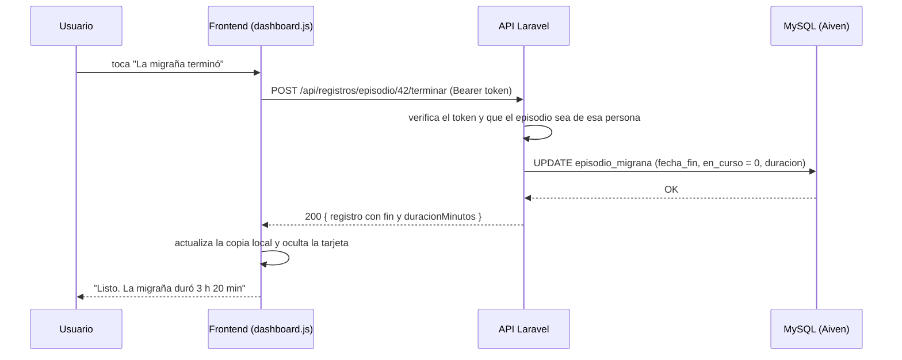

# Arquitectura

MigraSense está dividido en tres servicios independientes. Cada uno se puede actualizar sin tocar los demás,
y todos se comunican por HTTPS.

```mermaid
flowchart TB
    subgraph Navegador["Navegador del usuario (celular o PC)"]
        F[Frontend<br>HTML · CSS · JS<br>service worker]
    end
    subgraph Render
        B[API Laravel 9<br>Docker · PHP 8.2 · Apache]
        M[Servicio ML<br>FastAPI · scikit-learn]
    end
    D[(Aiven<br>MySQL 8.4)]
    G[GitHub Pages]
    CJ[cron-job.org]
    CO[Gmail Apps Script / Brevo]
    PS[Servicios push<br>FCM · Mozilla · Apple]

    G -- sirve archivos --> F
    F -- "fetch + Bearer token" --> B
    B -- "PDO + TLS" --> D
    B -- "POST /predecir (X-API-Key)" --> M
    CJ -- "cada 15 min (X-Cron-Key)" --> B
    B --> CO
    B --> PS --> F
```

## Frontend

- HTML, CSS y JavaScript **sin frameworks**, para que cargue rápido en celulares modestos.
- Cada pantalla tiene su archivo en `js/` (`registro.js`, `historial.js`, `dashboard.js`…).
  `js/api.js` concentra la comunicación con el servidor: guarda el token, reintenta cuando Render está
  "despertando" y mantiene una copia de los datos en el navegador para que la app siga mostrando algo si
  se corta el internet.
- `sw.js` (service worker) recibe las notificaciones push aunque la app esté cerrada.
- Se publica tal cual en **GitHub Pages**.

## Backend (API)

- **Laravel 9** en `Backend_Laravel/`, organizado en capas:
  - `routes/api.php` → rutas.
  - `app/Http/Requests` → validación de cada petición (FormRequest).
  - `app/Http/Controllers` → reciben la petición y arman la respuesta.
  - `app/Services` → la lógica: registros, estadísticas, reportes, predicción, correo, push.
  - `app/Support` → utilidades propias (Web Push con VAPID, PDF semanal).
- La autenticación es con **Laravel Sanctum** (token Bearer que vence a las 12 horas).
- Las escrituras importantes pasan por **procedimientos almacenados** en MySQL, que validan y guardan en
  una transacción; las lecturas usan **vistas**.
- Se despliega en **Render** con el `Dockerfile` de la carpeta.

## Base de datos

- **MySQL 8.4 en Aiven**, conexión cifrada con TLS y certificado de la autoridad de Aiven.
- La aplicación usa un usuario con permisos mínimos (`SELECT, INSERT, UPDATE, DELETE, EXECUTE`); los cambios
  de estructura se hacen con un usuario administrador aparte. Detalle en [base-de-datos.md](base-de-datos.md).

## Machine learning

- Servicio aparte en Python (repo [migrasence-ml](https://github.com/miguelhuanca676-bot/migrasence-ml)).
- **No** se conecta a la base de datos: Laravel le manda el perfil y los registros de la persona (sin
  nombre ni correo) y recibe la probabilidad y la explicación. Detalle en
  [machine-learning.md](machine-learning.md).

## Ejemplo: qué pasa al tocar "La migraña terminó"

## Decisiones importantes

| Decisión | Por qué |
|---|---|
| Frontend sin frameworks | El equipo ya lo tenía construido así y carga muy rápido; no hacía falta un paso de compilación. |
| Procedimientos almacenados para escribir | Las reglas (no fechas futuras, catálogos válidos) quedan protegidas aunque alguien escriba directo en la base. |
| ML como servicio separado | Python es mejor para el modelo, y si el ML se cae la app sigue funcionando con una estimación local. |
| Aiven y Render gratuitos | Sin costo para el proyecto; a cambio, Render "duerme" los servicios y la primera petición tarda. Por eso el frontend y el backend reintentan solos. |
| Web Push propio en vez de una librería | El entorno no permitía instalar paquetes nuevos; se implementó el estándar (RFC 8291/8292) y se verificó con el vector de prueba oficial. |
