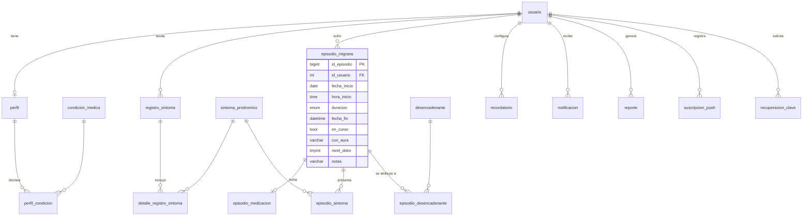

# Base de datos

Usamos **MySQL 8.4** alojado en **Aiven**, con juego de caracteres `utf8mb4_unicode_ci` y hora de Bolivia
(`-04:00`). La estructura completa está en `Backend_Laravel/database/aiven/migrasense_aiven.sql`; los scripts
originales, separados por tema, están en [`database/`](../database).

## Modelo de datos

## Tablas (23)

| Grupo | Tablas |
|---|---|
| Usuarios y perfil | `usuario`, `perfil`, `perfil_condicion`, `condicion_medica`, `patron_aparicion`, `consumo_cafeina`, `recuperacion_clave` |
| Catálogos | `sintoma_prodromico` (por `codigo`), `desencadenante` (por `codigo`) |
| Registros | `registro_sintoma`, `detalle_registro_sintoma`, `episodio_migrana`, `episodio_medicacion`, `episodio_sintoma`, `episodio_desencadenante` |
| Avisos | `recordatorio`, `notificacion`, `suscripcion_push`, `envio_recordatorio` |
| Reportes | `reporte`, `reporte_registro`, `reporte_episodio` |
| Machine learning | `modelo_ml` (historial de entrenamientos y métricas) |

Además están las tablas propias de Laravel: `migrations`, `personal_access_tokens` y `failed_jobs`.

## Vistas (6)

| Vista | Para qué |
|---|---|
| `v_historial` | Une síntomas prodrómicos y episodios en una sola lista |
| `v_resumen_30dias` | Tarjetas de resumen: episodios, síntomas e intensidad media de los últimos 30 días |
| `v_episodios_semana` | Episodios y dolor medio por semana (lunes a domingo) |
| `v_desencadenantes_frecuentes` | Desencadenantes más repetidos por persona |
| `v_sintomas_frecuentes` | Síntomas más repetidos por persona |
| `v_perfil_completo` | Perfil con sus etiquetas legibles |

## Procedimientos almacenados (11)

`sp_registrar_usuario`, `sp_guardar_perfil`, `sp_registrar_prodromico`, `sp_registrar_episodio`,
`sp_editar_registro`, `sp_eliminar_registro`, `sp_historial_usuario`, `sp_guardar_recordatorio`,
`sp_crear_notificacion`, `sp_marcar_notificacion`, `sp_generar_reporte`.

Todos trabajan dentro de una transacción y, si algo no cumple una regla, devuelven un error `SQLSTATE 45000`
con un mensaje pensado para la persona (la API lo convierte en un 422).

## Triggers (5)

| Trigger | Qué hace |
|---|---|
| `trg_usuario_bi`, `trg_usuario_bu` | Guardan el correo en minúsculas |
| `trg_usuario_ai` | Crea los recordatorios por defecto (diario 20:00 y semanal domingo 19:00) |
| `trg_episodio_bi`, `trg_registro_sintoma_bi` | Impiden registrar fechas en el futuro |

## Usuarios de la base

| Usuario | Permisos | Uso |
|---|---|---|
| `migrasense_app` | `SELECT, INSERT, UPDATE, DELETE, EXECUTE` solo sobre `migrasense`, con `REQUIRE SSL` | La API en el día a día |
| `avnadmin` | Administrador | Solo migraciones e importaciones (`--database=mysql_admin`) |

## Migraciones

Cada cambio de estructura es una migración de Laravel en `Backend_Laravel/database/migrations`. Todas
revisan si la tabla o columna ya existe antes de crearla, así que se pueden correr varias veces sin
romper nada. La más reciente, `2026_10_22_000001_add_fin_aura_to_episodio_migrana`, agrega la hora de fin,
el estado "en curso" y el aura a los episodios.
