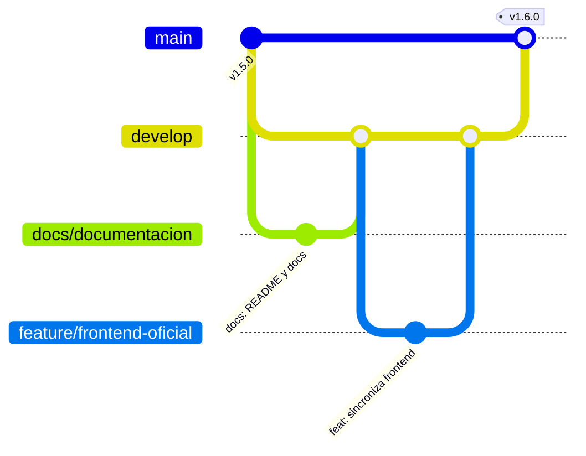

# Gestión del proyecto

Este documento explica cómo administramos el desarrollo de MigraSense con Git y GitHub. Las reglas del día a
día están en [CONTRIBUTING.md](../CONTRIBUTING.md).

## Repositorios

| Repositorio | Contenido | Rol |
|---|---|---|
| [jose-14-mvj/Proyecto-De-Sistemas](https://github.com/jose-14-mvj/Proyecto-De-Sistemas) | Frontend, backend Laravel, scripts SQL y documentación | **Repositorio oficial** del proyecto |
| [miguelhuanca676-bot/migrasense](https://github.com/miguelhuanca676-bot/migrasense) | Copia del frontend publicada en GitHub Pages | Publicación |
| [miguelhuanca676-bot/migrasence-ml](https://github.com/miguelhuanca676-bot/migrasence-ml) | Servicio de machine learning | Servicio aparte (otro lenguaje y otro despliegue) |

## Cómo evolucionó el proyecto

| Etapa | Fechas | Qué se hizo |
|---|---|---|
| Prototipo del frontend | 29 sep – 8 oct | Pantallas, cuestionario, historial, consejos, PDF, predicción por reglas (datos en el navegador) |
| Base de datos | 9 oct | Diseño en SQL: tablas, catálogos, vistas, procedimientos y triggers; primera API en PHP |
| Backend Laravel | 12 – 13 oct | Autenticación segura, API completa, migraciones, pruebas |
| Nube | 13 oct | Base en Aiven, API y ML en Render, frontend conectado |
| Funciones nuevas | 14 – 16 oct | Recuperar contraseña, memoria del ML, edición completa, recordatorios push |
| Correcciones de uso | 16 – 21 oct | Rediseño UX, migraña en curso, aura, fecha en síntomas |
| Documentación y gestión | 21 oct | README, docs, manual, issues, tablero y versiones |

El detalle de cada versión está en el [CHANGELOG](../CHANGELOG.md).

## Ramas

- `main`: lo publicado. Protegida: solo recibe cambios por pull request.
- `develop`: donde se integran las tareas.
- `feature/…`, `fix/…`, `docs/…`: una rama por issue.

Hasta la versión 1.5.0 el equipo trabajó directamente sobre `main` (se ve en el historial de commits).
Desde la 1.6.0 todo entra por ramas y pull requests.

## Commits

Mensajes en español con prefijo (`feat:`, `fix:`, `docs:`, `refactor:`, `test:`, `chore:`). Ejemplo:
`fix: la duración ya no es obligatoria cuando la migraña sigue en curso`.

## Issues y tablero

- Cada tarea o error es un **issue** con etiquetas (parte del sistema, tipo y prioridad) y un **hito** que
  corresponde a la versión donde se entregó o se entregará.
- Lo que ya estaba hecho antes de usar issues también se registró, con el commit donde se hizo, y se cerró.
  Así el tablero muestra el proyecto completo y no solo lo último.
- El **tablero** (pestaña *Projects*) tiene las columnas **Por hacer → En progreso → En revisión → Hecho**.
  Un issue se cierra solo cuando se fusiona el pull request que dice `Closes #N`.

## Pull requests

Cada PR enlaza su issue, explica cómo se probó y lo revisa otro integrante antes de fusionarse. La plantilla
está en `.github/pull_request_template.md`.

## Versiones

Versionado semántico (`MAYOR.MENOR.PARCHE`). Cada versión tiene:

1. una etiqueta de Git (`v1.5.0`) sobre el commit exacto que se publicó,
2. un *release* en GitHub con el resumen de cambios,
3. su sección en el [CHANGELOG](../CHANGELOG.md).

| Versión | Fecha | Resumen |
|---|---|---|
| v0.1.0 | 2026-09-29 | Prototipo del frontend |
| v0.2.0 | 2026-10-08 | Reportes PDF y diseño adaptable |
| v0.3.0 | 2026-10-09 | Base de datos y primera API |
| v0.4.0 | 2026-10-12 | Backend en Laravel |
| v1.0.0 | 2026-10-13 | Primera versión completa en la nube |
| v1.1.0 | 2026-10-14 | Recuperar contraseña |
| v1.2.0 | 2026-10-16 | Memoria del modelo de ML |
| v1.3.0 | 2026-10-16 | Correcciones de uso y edición completa |
| v1.4.0 | 2026-10-16 | Recordatorios reales |
| v1.5.0 | 2026-10-21 | Migraña en curso y aura |
| v1.6.0 | 2026-10-21 | Repositorio oficial y documentación |

## Pruebas

`php artisan test` corre 104 pruebas automáticas (autenticación, registros, permisos entre usuarios,
recordatorios, reportes, predicción, seguridad) sobre una base SQLite en memoria. Antes de cada versión se
prueba además el flujo completo en el navegador, en celular y en PC.
