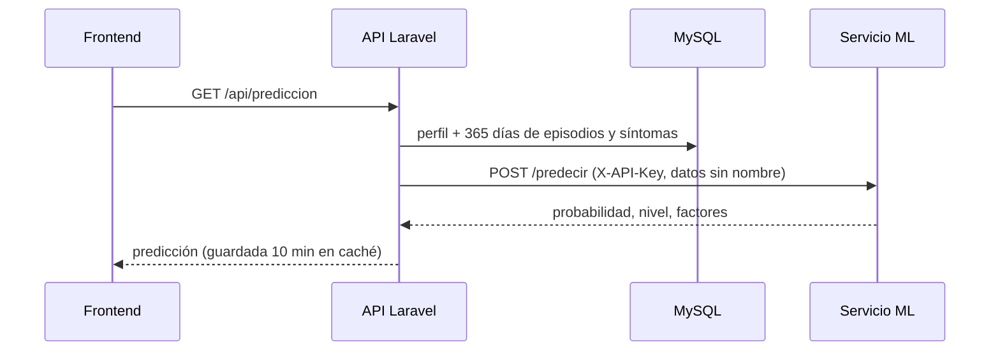

# Machine learning

El código del modelo vive en un repositorio aparte:
[miguelhuanca676-bot/migrasence-ml](https://github.com/miguelhuanca676-bot/migrasence-ml), publicado en
`https://migrasence-ml.onrender.com`.

## Qué predice

La **probabilidad de que empiece una migraña en las próximas 48 horas** para una persona, usando su
cuestionario inicial y lo que viene registrando en la app.

| Probabilidad | Nivel que ve la persona |
|---|---|
| menos de 25 % | Bajo |
| 25 % a 49 % | Moderado |
| 50 % a 69 % | Alto |
| 70 % o más | Muy alto (y se envía el aviso de posible migraña, máximo 1 cada 24 h) |

## Con qué aprende

Al principio no había datos reales, así que el modelo arranca con **conocimiento de estudios médicos**:

1. `conocimiento.py` reúne cifras publicadas sobre síntomas premonitorios y desencadenantes (Giffin 2003,
   Kelman 2007, MacGregor 2004, Lipton 2014, Mostofsky 2019, criterios ICHD-3). Lo que no tiene fuente está
   marcado como `[SUPUESTO]`.
2. `simulador.py` crea 1.600 personas ficticias que siguen esas reglas: frecuencia propia, ciclo hormonal,
   rachas de estrés, avisos entre 2 y 48 h antes, falsas alarmas y días sin registrar.
3. `caracteristicas.py` convierte los registros en unas 50 variables (episodios recientes, días desde el
   último, síntomas de las últimas 48 h, perfil, hora del día…). Es el mismo código para entrenar y para
   predecir, y nunca usa información del futuro.
4. `entrenar.py` entrena un **Gradient Boosting calibrado** (scikit-learn).

Cuando la app junta datos reales, Laravel se los envía **sin nombre ni correo** y el modelo se reentrena
dándoles el triple de peso que a los simulados.

## Qué tan bien funciona

Evaluado con personas simuladas que el modelo **nunca vio** durante el entrenamiento:

| Modelo | AUC | Brier |
|---|---|---|
| **MigraSense (Gradient Boosting)** | **0,887** | **0,129** |
| Solo con el cuestionario | 0,775 | 0,200 |
| Modelo lineal simple | 0,863 | 0,145 |

Cuando el modelo dice "70 % o más", acierta en el 85 % de los casos. Hay que leer estas cifras con cuidado:
miden qué tan bien aprende los patrones de la literatura médica, no todavía con pacientes reales. Esa
prueba aparece en `GET /metricas` cuando haya al menos 5 personas y 200 momentos con seguimiento.

## Cómo se conecta

Si el servicio de ML no responde (por ejemplo, porque Render lo durmió), Laravel reintenta varias veces y,
si aun así falla, el frontend muestra una estimación local por reglas con el aviso correspondiente.
