# Manual de usuario

Este manual explica cómo usar MigraSense paso a paso. Las capturas son de un celular, pero en una tablet o
en la computadora las pantallas son las mismas (en la PC el menú aparece a la izquierda en lugar de abajo).

**Dirección de la app:** https://miguelhuanca676-bot.github.io/migrasense/

> La primera vez que abres la app en el día puede aparecer "Conectando con el servidor… la primera vez puede
> tardar hasta 1 minuto". Es normal: el servidor gratuito se "duerme" cuando nadie lo usa. Espera un momento
> y la app sigue sola.

## Contenido

1. [Crear tu cuenta](#1-crear-tu-cuenta)
2. [Responder el cuestionario inicial](#2-responder-el-cuestionario-inicial)
3. [La pantalla de Inicio](#3-la-pantalla-de-inicio)
4. [Registrar un síntoma prodrómico](#4-registrar-un-síntoma-prodrómico)
5. [Registrar una migraña](#5-registrar-una-migraña)
6. [Marcar que la migraña terminó](#6-marcar-que-la-migraña-terminó)
7. [Revisar tu historial](#7-revisar-tu-historial)
8. [Sacar el reporte para tu médico](#8-sacar-el-reporte-para-tu-médico)
9. [Consejos](#9-consejos)
10. [Recordatorios](#10-recordatorios)
11. [Tu perfil y tu cuenta](#11-tu-perfil-y-tu-cuenta)
12. [Si olvidaste tu contraseña](#12-si-olvidaste-tu-contraseña)
13. [Preguntas frecuentes](#13-preguntas-frecuentes)

---

## 1. Crear tu cuenta

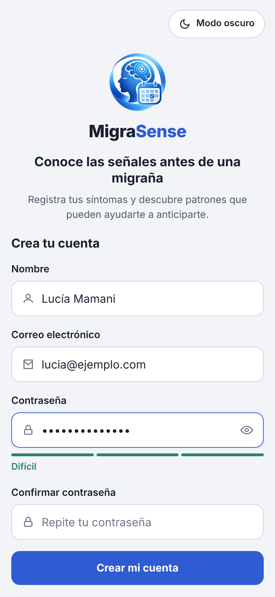

1. Abre la app y toca **Regístrate**.
2. Escribe tu nombre, tu correo y una contraseña.
3. La contraseña debe tener **al menos 10 caracteres**, con una mayúscula, una minúscula y un número. La barra
   de colores te dice si es débil o fuerte.
4. Repite la contraseña y toca **Crear mi cuenta**.

Si ya tienes cuenta, en la pantalla de inicio de sesión escribe tu correo y contraseña y toca
**Iniciar sesión**. Si marcas **Recordarme**, no tendrás que volver a escribirlos en ese dispositivo.

 

## 2. Responder el cuestionario inicial

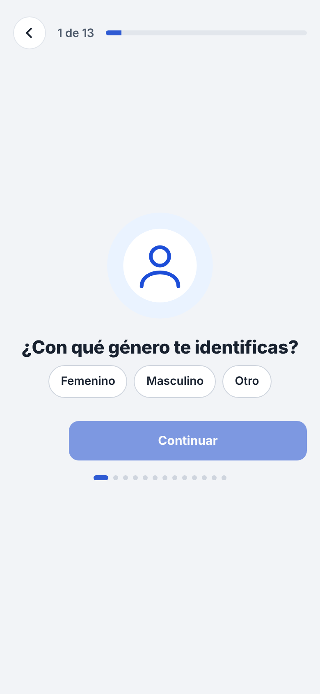

Después de crear la cuenta, la app te hace **13 preguntas** sobre tu migraña: con qué frecuencia te da,
cuánto dura, a qué hora suele empezar, cuánto duermes, tu nivel de estrés, si tomas café y si tienes alguna
condición médica.

- Elige una respuesta y toca **Continuar**.
- Con la flecha de arriba puedes volver a la pregunta anterior.
- Responde con sinceridad: estas respuestas ayudan a que la predicción sea más acertada desde el primer día.

Puedes cambiar tus respuestas más adelante desde **Perfil → Perfil de migraña**.

 

## 3. La pantalla de Inicio

Es lo primero que ves al entrar. De arriba hacia abajo:

- **Predicción de hoy**: la probabilidad de que tengas una migraña en las **próximas 48 horas**. El color de
  la barra cambia según el nivel: verde (bajo), naranja (moderado) o rojo (alto).
- **¿Por qué este resultado?**: abre una explicación con los factores que subieron o bajaron tu porcentaje y
  tus patrones (cuántos episodios, intensidad media, días más frecuentes, desencadenantes que más se repiten).
- **Registrar síntoma prodrómico** y **Registrar una migraña**: accesos rápidos a los formularios.
- **Ver mis patrones**: la misma explicación de arriba.
- **Registros recientes** y **Recordatorios**: tus últimas anotaciones y los interruptores para activar o
  apagar los avisos.

La predicción mejora a medida que registras más. Con pocos registros verás que la confianza es "baja".

 

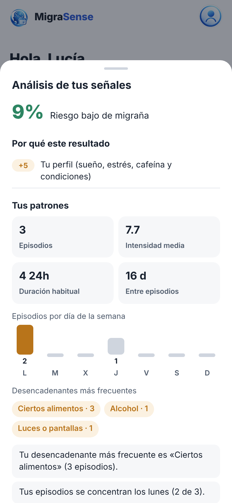

## 4. Registrar un síntoma prodrómico

Los **síntomas prodrómicos** son señales que aparecen horas o días antes del dolor: bostezos repetidos,
cansancio, rigidez en el cuello, sensibilidad a la luz, antojos, dificultad para concentrarte, etc.
Anotarlos es lo que más ayuda a predecir.

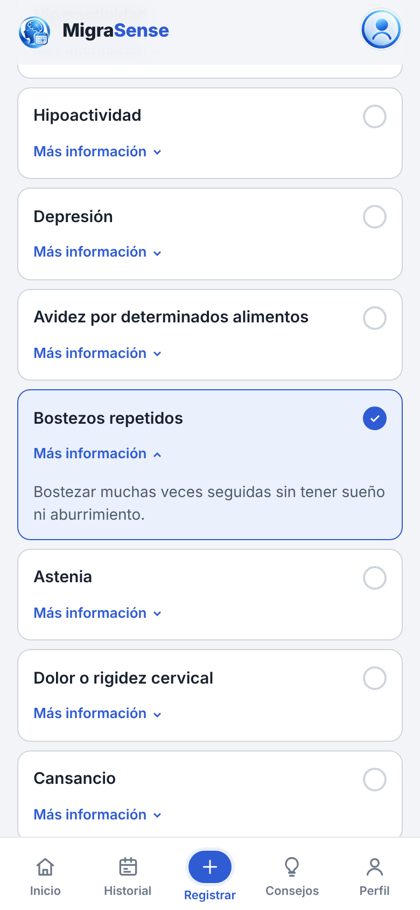 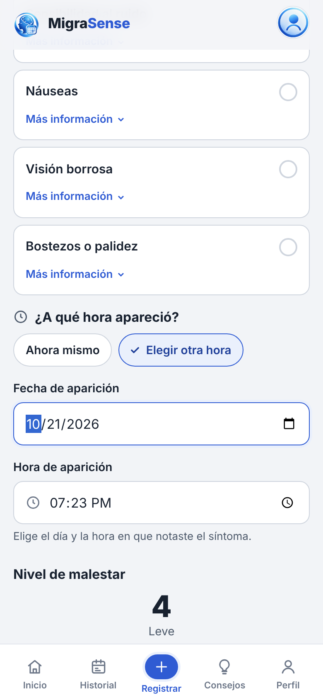

1. En Inicio toca **Registrar síntoma prodrómico**.
2. Elige **el síntoma** que notas. Si no estás seguro de qué significa, toca **Más información** debajo de
   cada uno.
3. En **¿A qué hora apareció?**:
   - **Ahora mismo** si lo estás sintiendo en este momento.
   - **Elegir otra hora** si lo notaste antes: aparecen la **fecha** y la **hora** para que indiques cuándo.
4. Mueve la barra de **Nivel de malestar** (1 = muy leve, 10 = muy fuerte).
5. Si quieres, escribe una nota (por ejemplo, "después de estudiar 4 horas en la compu").
6. Toca **Guardar registro**.

Si notas varios síntomas, regístralos uno por uno.

## 5. Registrar una migraña

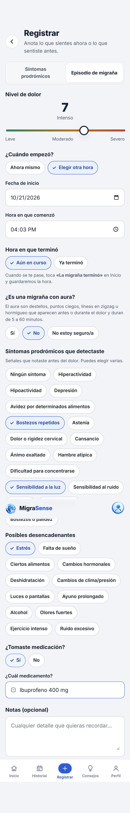

1. En Inicio toca **Registrar una migraña** (o en el botón **+** de abajo, pestaña **Episodio de migraña**).
2. Mueve la barra de **Nivel de dolor**.
3. En **¿Cuándo empezó?**:
   - **Ahora mismo**: la fecha y la hora se llenan solas, y la migraña queda **"Aún en curso"**. Úsalo cuando
     tienes la migraña en este momento y todavía no sabes cuándo va a terminar.
   - **Elegir otra hora**: escribe la fecha y la hora en que empezó. Después elige:
     - **Aún en curso**, si todavía te duele.
     - **Ya terminó**, y escribe la hora en que terminó. La app calcula la duración exacta. Si la hora de fin es
       menor que la de inicio, entiende que terminó al día siguiente.
4. Responde **¿Es una migraña con aura?** El aura son destellos, puntos ciegos, líneas en zigzag u hormigueo
   que aparecen antes o durante el dolor. Si no sabes, elige **No estoy seguro/a**.
5. En **Síntomas prodrómicos que detectaste** marca las señales que notaste **antes** del dolor (puedes
   elegir varias), o **Ningún síntoma**.
6. Marca los **posibles desencadenantes** (estrés, falta de sueño, ciertos alimentos, pantallas…).
7. Indica si **tomaste medicación** y cuál.
8. Toca **Guardar episodio**.

> Solo puede haber **una migraña en curso a la vez**. Si ya tienes una marcada, el formulario te lo avisa y
> solo te deja anotar migrañas que ya terminaron.

 

## 6. Marcar que la migraña terminó

 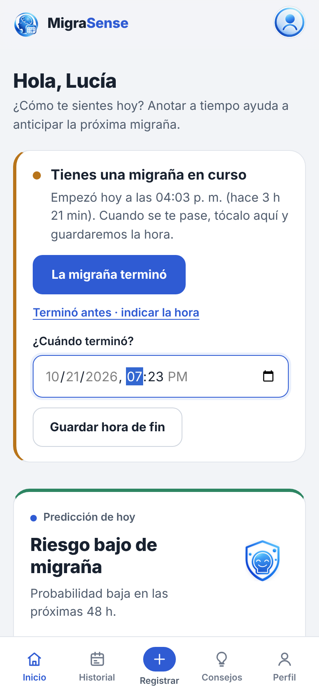

Mientras tengas una migraña en curso, en Inicio aparece la tarjeta **"Tienes una migraña en curso"** con la
hora en que empezó y cuánto tiempo lleva.

- Cuando se te pase, toca **La migraña terminó**: se guarda la hora de ese momento y se calcula la duración.
- Si se te pasó antes y te olvidaste de marcarlo, toca **Terminó antes · indicar la hora**, elige la fecha y
  hora reales y toca **Guardar hora de fin**.
- Si pasan **más de 3 días** y sigue marcada como en curso, la tarjeta se pone roja y te pregunta
  directamente a qué hora terminó, para que tu historial quede bien.

## 7. Revisar tu historial

 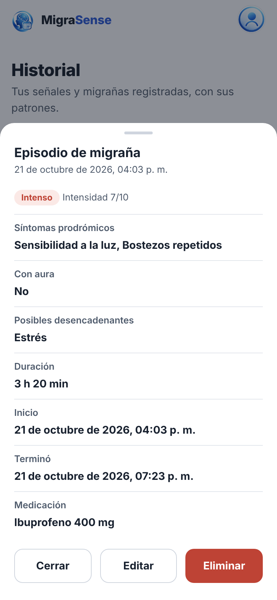

En **Historial** (menú de abajo) ves:

- Un resumen: episodios de los últimos 30 días, intensidad media y total de registros.
- Filtros: **Todos**, **Prodrómicos** o **Episodios**, en vista de **Lista** o **Calendario**.
- Gráficos con tus episodios por semana y la intensidad a lo largo del tiempo.

Toca cualquier registro para ver el detalle: síntomas, si tuvo aura, desencadenantes, duración, hora de inicio
y de fin, y medicación. Desde ahí puedes **Editar** (se abre el mismo formulario con los datos cargados) o
**Eliminar**.

## 8. Sacar el reporte para tu médico

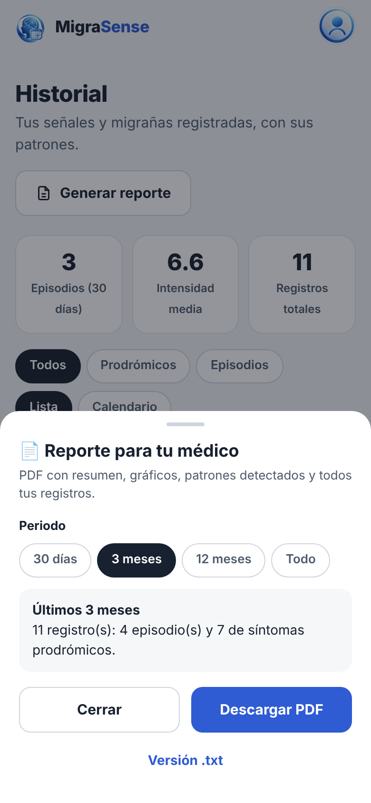

1. En **Historial** toca **Generar reporte** (o en **Perfil → Reporte para tu médico**).
2. Elige el periodo: **30 días**, **3 meses**, **12 meses** o **Todo**.
3. Toca **Descargar PDF**. En el celular también puedes **compartirlo** directamente (WhatsApp, correo…).

El PDF incluye tus datos del cuestionario, un resumen escrito, gráficos, los patrones detectados y la tabla
con todos tus registros del periodo. Si lo necesitas en texto simple, toca **Versión .txt**.

 

## 9. Consejos

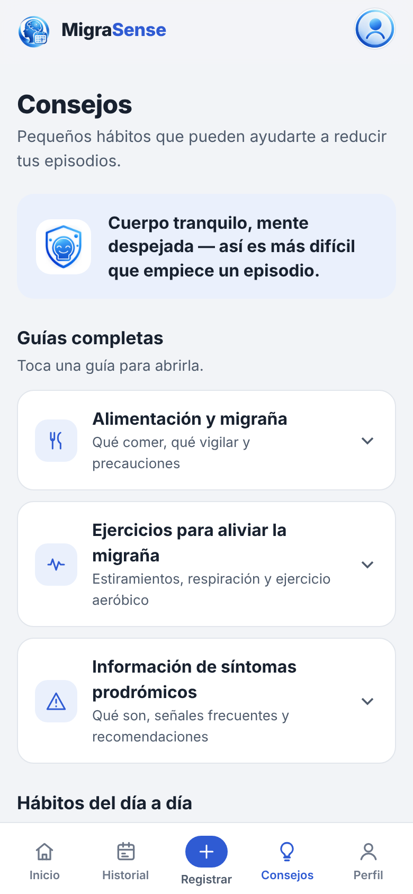

En **Consejos** hay guías cortas sobre alimentación, ejercicios para aliviar la tensión (cuello, hombros,
espalda, respiración), qué son los síntomas prodrómicos y hábitos del día a día. Toca cada guía para abrirla.

 

## 10. Recordatorios

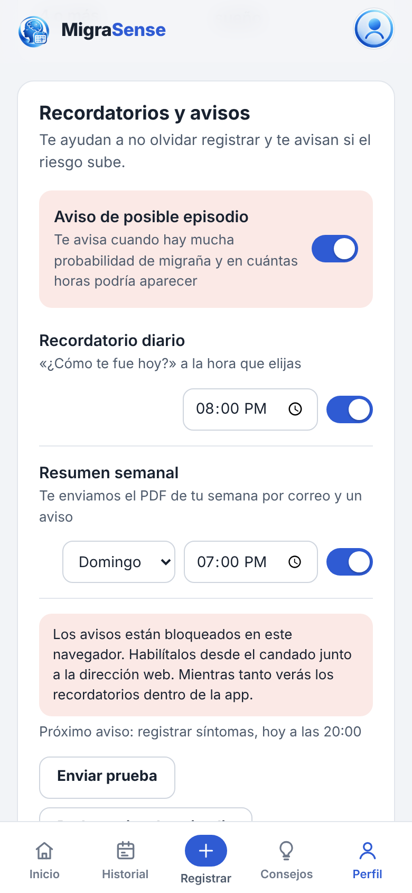

En **Perfil → Recordatorios y avisos** puedes activar:

- **Recordatorio diario**: a la hora que elijas te llega "¿Cómo te fue hoy?" para que registres. Si ese día ya
  registraste algo, no te molesta.
- **Resumen semanal**: el día y la hora que elijas te llega un aviso y el **PDF de tu semana por correo**.
- **Aviso de posible episodio**: si la predicción llega a un riesgo muy alto, te avisa (como máximo una vez al
  día).

Los avisos llegan **aunque la app esté cerrada**, siempre que le des permiso al navegador. Si ves el mensaje
"Los avisos están bloqueados en este navegador", toca el candado junto a la dirección web, permite las
notificaciones y vuelve a entrar. Con **Enviar prueba** compruebas que funciona.

 

## 11. Tu perfil y tu cuenta

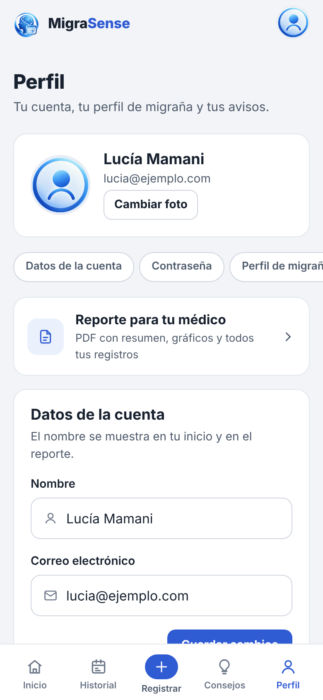

En **Perfil** puedes:

- Cambiar tu **foto**, **nombre** y **correo**.
- Cambiar tu **contraseña** (te pide la actual).
- Ver y **volver a responder el cuestionario** de migraña.
- Elegir **modo claro u oscuro**.
- **Cerrar sesión**.
- **Eliminar tu cuenta**: borra tu cuenta y **todos** tus registros de forma permanente. Te pide la contraseña
  para confirmar.

 

## 12. Si olvidaste tu contraseña

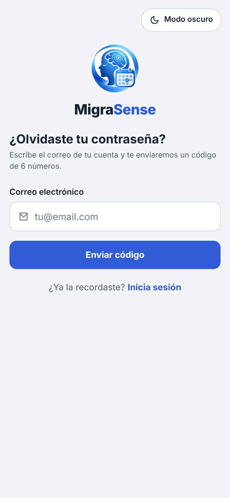

1. En la pantalla de inicio de sesión toca **¿Olvidaste tu contraseña?**
2. Escribe tu correo y toca **Enviar código**.
3. Revisa tu correo (también la carpeta de spam): llega un **código de 6 números**.
4. Escribe el código y tu nueva contraseña.

Puedes pedir hasta 5 códigos por día, con al menos un minuto entre cada uno.

 

## 13. Preguntas frecuentes

**¿La predicción es un diagnóstico?**
No. Es una estimación orientativa hecha con tus propios registros. Ante cualquier duda o un dolor distinto
al habitual, consulta con un médico.

**¿Por qué mi predicción dice "confianza baja"?**
Porque todavía hay pocos registros. Con unas semanas de anotar síntomas y migrañas, la predicción se ajusta
a tu propio ritmo.

**¿Mis datos están seguros?**
Tu contraseña se guarda cifrada, la conexión siempre es segura (HTTPS) y nadie más puede ver tus registros.
Puedes borrar tu cuenta y todos tus datos cuando quieras.

**¿Funciona sin internet?**
Puedes ver lo último que se cargó, pero para guardar registros necesitas conexión.

**¿Puedo instalarla como una app?**
Sí. En el celular, abre el menú del navegador y elige **Agregar a la pantalla de inicio** (o **Instalar
app**). Se abrirá como una aplicación más.

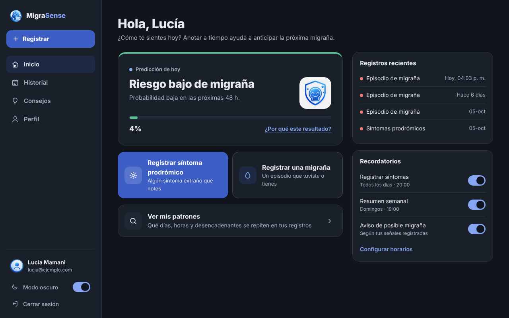

